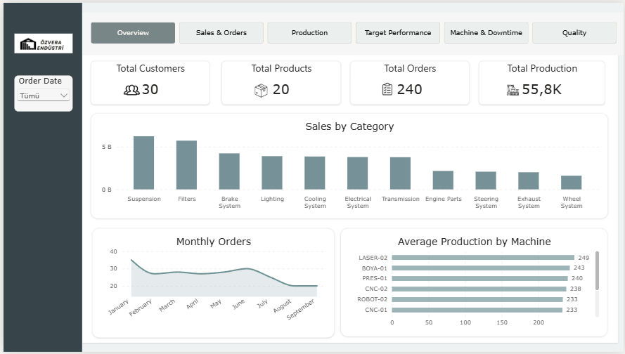
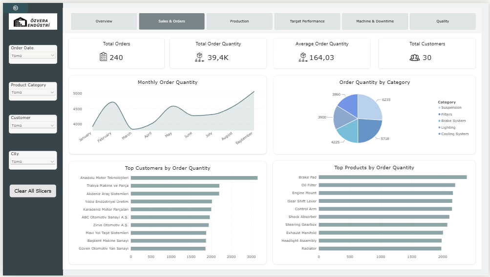
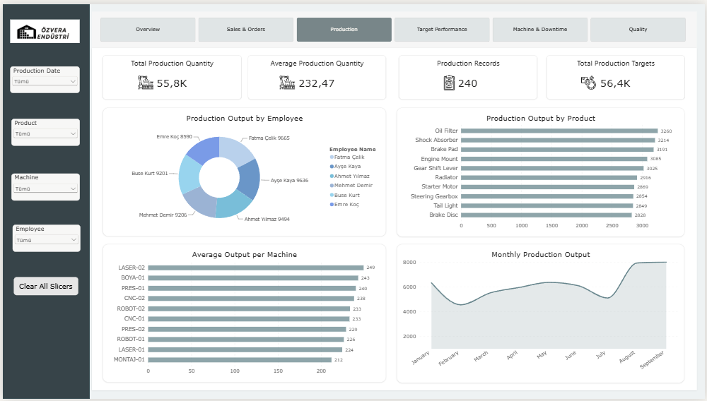
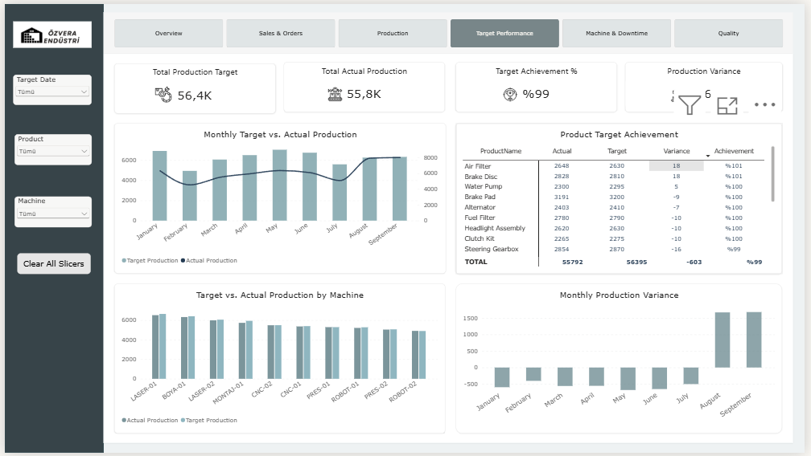
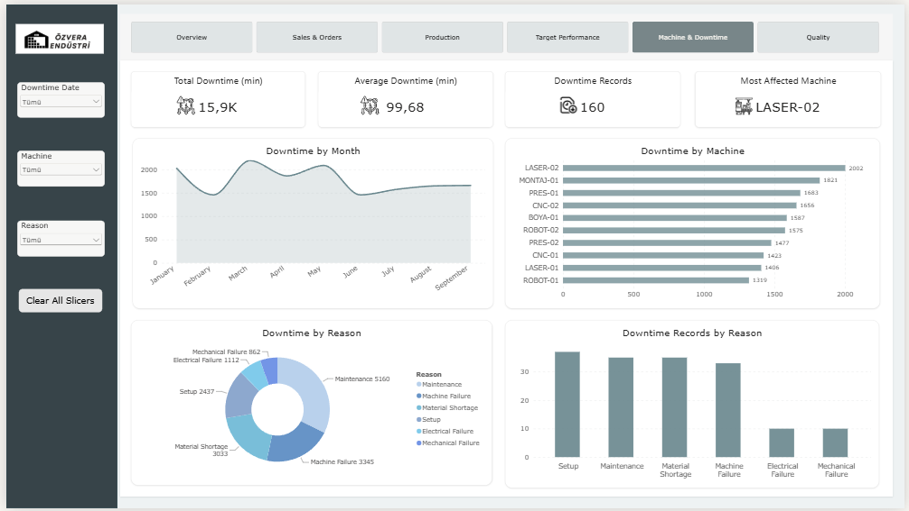
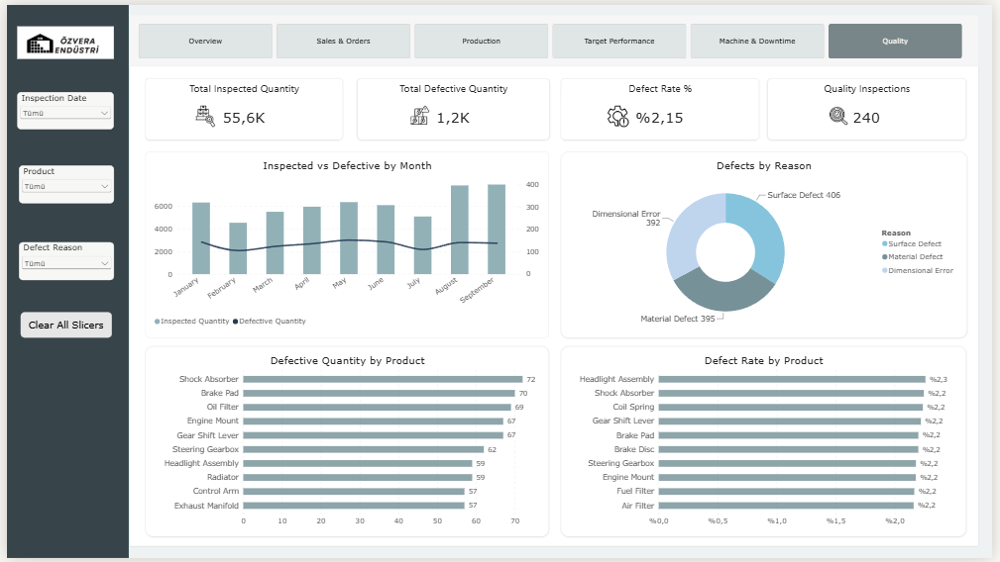

# Özvera Endüstri — Manufacturing Data Analysis

## Project Overview
Özvera Endüstri is a fictional manufacturing company used for a data analysis portfolio project. The project focuses on analyzing sales, production, production targets, machine downtime, and quality control data using SQL Server and Power BI.

## Objectives
- Analyze sales and order trends.
- Evaluate production performance against targets.
- Identify machine downtime patterns.
- Analyze product quality and defect rates.
- Build interactive dashboards to support data-driven decision-making.

## Tools & Technologies
- Microsoft SQL Server
- SQL
- Microsoft Power BI
- DAX
- Excel

## Dataset
The project uses simulated manufacturing data covering January–September 2026.

The dataset includes:
- Customers
- Products
- Orders
- Production Orders
- Production Targets
- Machines
- Employees
- Quality Control
- Machine Downtime

## Power BI Dashboard Pages
1. Overview
2. Sales & Orders
3. Production
4. Target Performance
5. Machine & Downtime
6. Quality

## Key Analysis Areas
- Sales quantity and customer performance
- Monthly production output
- Target achievement and production variance
- Machine downtime analysis
- Quality inspection and defect rate analysis

## Project Status
SQL analysis and Power BI dashboard development are completed. The repository will include SQL scripts, dashboard screenshots, and project documentation.

## Disclaimer
This is a fictional portfolio project. The data is simulated and does not represent a real company or its operations.

## Dashboard Screenshots

### 1. Overview

### 2. Sales & Orders

### 3. Production

### 4. Target Performance

### 5. Machine & Downtime

### 6. Quality

